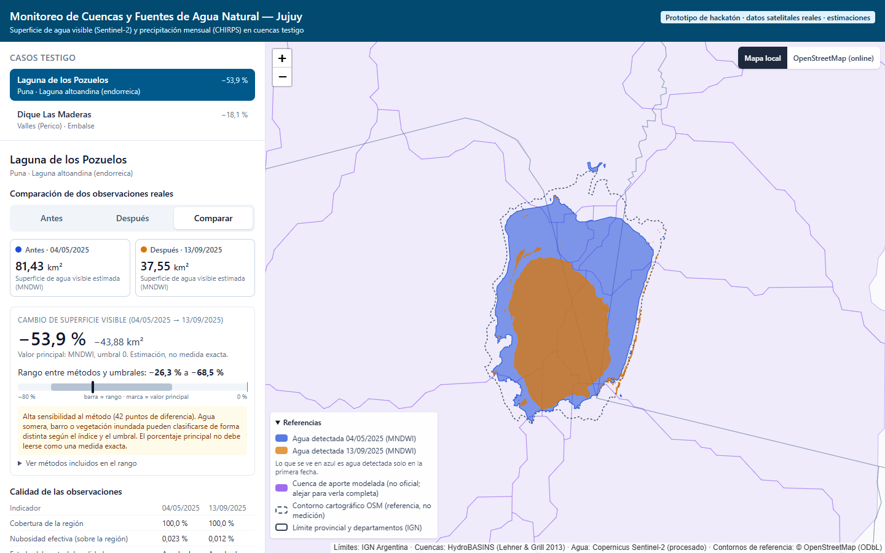

# AquaJuy

Plataforma geoespacial que compara la **superficie de agua visible** de lagunas y embalses de Jujuy entre dos fechas reales de Sentinel-2, la acompaña con la **precipitación mensual estimada** de su cuenca de aporte modelada, una **serie climática estimada** y un **simulador demostrativo** de escenarios. Fuentes, fechas, incertidumbre y límites quedan visibles en la interfaz.

> Nombre comercial: **AquaJuy**. El repositorio (`monitoreo-hidrico-jujuy`) y la URL de producción conservan su nombre técnico.



## Problema y solución
- **Problema:** responder de forma simple y verificable si un espejo de agua de Jujuy está más chico que en otra fecha, y en qué contexto de lluvias. Los datos existen (satélites, productos climáticos, modelos de cuencas), pero están dispersos y requieren conocimiento técnico.
- **Solución:**
  - Un dashboard web estático con mapa interactivo y un comparador Antes/Después de dos observaciones reales.
  - Métricas precalculadas con scripts reproducibles.
  - Rango de incertidumbre entre métodos.
  - Contexto climático y un simulador **experimental**, separados de las observaciones.

## Alcance real del MVP
| Caso | Fechas comparadas | Superficie visible (MNDWI) | Cambio principal | Rango entre métodos y umbrales |
|---|---|---|---|---|
| Laguna de los Pozuelos (Puna) | 04/05/2025 → 13/09/2025 | 81,43 → 37,55 km² | −53,9 % | −26,3 % a −68,5 % |
| Dique Las Maderas (Valles) | 29/05/2025 → 03/10/2025 | 8,72 → 7,14 km² | −18,1 % | −13,0 % a −18,9 % |

Los valores provienen de `data/derived/water_metrics.json`; el frontend los lee y no los recalcula.

### Tres tipos de información, siempre separados en la interfaz
| | Qué es | Fuente | Rótulo |
|---|---|---|---|
| **A. Observaciones** | Superficie de agua visible en 2 fechas por caso | Copernicus Sentinel-2 L2A (MNDWI/NDWI) | Estimación a partir de observación satelital |
| **B. Clima estimado** | Precipitación mensual en la cuenca (CHIRPS v3.0, media areal) y serie mensual 2019–2026 de lluvia y temperatura en un punto (Open-Meteo Historical, reanálisis) | CHIRPS, Open-Meteo | Estimación, no medición de estación |
| **C. Escenarios simulados** | Superficie que resultaría de un escenario de lluvia y temperatura | `HistGradientBoostingRegressor` entrenado con **datos sintéticos** | «Simulador climático — demostración experimental» |

**Fuera de alcance:**
- Volumen almacenado, caudal y aguas subterráneas.
- Tendencias y pronósticos validados.
- Alertas.
- Evaporación.
- Datos del SMN.
- Cobertura provincial completa.

## Datos y fuentes
| Fuente | Uso | Acceso |
|---|---|---|
| Copernicus Sentinel-2 L2A | B03, B08, B11 y SCL → NDWI y MNDWI, máscara de nubes | Microsoft Planetary Computer (STAC + COG, sin cuenta) |
| CHIRPS v3.0 mensual (CHC, UCSB) | Precipitación estimada, `mm/month`, 0,05°, media areal en la cuenca, referencia 1995–2024 | `data.chc.ucsb.edu` |
| Open-Meteo Historical Weather API | Lluvia (mm/mes) y temperatura media (°C) diarias agregadas por mes, 2019-03 a 2026-10, **en el centro del área de interés** (no promedio de cuenca) | `archive-api.open-meteo.com`; reanálisis con el modelo por defecto de Open-Meteo (no se forzó ERA5-Land) |
| HydroBASINS v1c nivel 10 (HydroSHEDS) | Cuenca de aporte **modelada** (no oficial) | `data.hydrosheds.org` |
| OpenStreetMap | Contornos cartográficos de referencia del lago y del embalse (no medición) | Overpass API, ODbL |
| IGN Argentina | Límite provincial y departamentos (mapa base local) | WFS `wms.ign.gob.ar`; licencia por verificar |

- **Diferencia entre fuentes de lluvia:** en los meses analizados, Open-Meteo (punto) da entre 1,4 y 3 veces la precipitación de CHIRPS (cuenca). No deben compararse entre sí.
- **Detalle de fuentes:** `data/raw/MANIFEST.md`, `data/derived/MANIFEST.md`, `DATA_SOURCES.md`, `DECISIONS.md` y `docs/JULI_INTEGRATION_REPORT.md`.

## Simulador climático — demostración experimental
- **Qué hace:** interpola una grilla de 61×61 exportada por `HistGradientBoostingRegressor` (`data/derived/model/water_model.json`, generada por `scripts/model/build_climate_model.py`).
- **Con qué se entrenó:** con una **respuesta sintética**, calibrada a las 2 observaciones reales de cada caso. La sensibilidad a la temperatura es un supuesto fijo (−5 % por +5 °C).
- **Qué no es:** un pronóstico ni una predicción validada; no reemplaza mediciones de campo. Su R² sobre datos sintéticos no valida el modelo frente a la realidad.

## Tecnologías
- **Frontend:** Next.js 16 (exportación estática, sin backend obligatorio), TypeScript, Tailwind CSS 4 y Leaflet 1.9 con render Canvas.
- **Preprocesamiento:** Python 3.13 con `rasterio` y `pyshp`; clima y modelo con `requests` y `scikit-learn==1.9.1`, en `scripts/`.
- **Pruebas:**
  - `node --test` para unitarias de TypeScript.
  - `unittest` para Python.
  - Playwright para E2E, con el Chrome instalado.

## Instalación y uso
Requisitos: Node.js ≥ 22.18 (las pruebas usan TypeScript nativo de Node; el build funciona desde 20.9) y npm.

```bash
npm ci
npm run dev        # http://localhost:3000 = landing; /demo = dashboard (publica data/derived -> public/data)
npm run build      # exportación estática en out/
npm start          # sirve out/ en http://127.0.0.1:3000 (servidor estático local, sin descargas)
```

Pruebas:
```bash
npm run lint && npm run typecheck
npm test                    # unitarias TS + integridad de datos publicados
npm run test:py             # QA Python (usa scripts/.venv si existe; si no, el Python del sistema con numpy)
npm run test:e2e:smoke      # E2E acotado (build previo; tope 120 s)
npm run test:e2e            # E2E completo
```

Reprocesar los datos (opcional; descarga datos públicos):
```bash
python -m venv scripts/.venv
scripts/.venv/Scripts/python -m pip install -r scripts/requirements.txt
cd scripts/explore && ../.venv/Scripts/python 01_osm_cases.py      # ver scripts/README.md (observaciones)
scripts/.venv/Scripts/python scripts/model/build_climate_model.py  # clima Open-Meteo + modelo demostrativo
```
`build_climate_model.py` usa el período 2019-01 → hoy − 2 días y una caché local (`data/raw/climate`). Volver a correrlo otro día cambia la serie publicada.

## API opcional (módulo separado; no la usa la demo)
`server/index.js` (Node sin dependencias, `npm run start:api`) sirve `out/` y expone una API de solo lectura sobre los mismos JSON:
- **Rutas:** `/api/health`, `/api/meta`, `/api/casos`, `/api/casos/{id}`, `/api/casos/{id}/comparacion`, `/api/casos/{id}/precipitacion`, `/api/casos/{id}/historial`, `/api/casos/{id}/modelo`, `/api/casos/{id}/geometrias`, `/api/fuentes` y `/api/openapi.json`.
- **Variables:** `PORT`, `HOST`, `STATIC_DIR`, `DATA_DIR` y `LOG_REQUESTS`.
- **Despliegue:** `Dockerfile` y `render.yaml` permiten publicar front y API juntos en Docker o Render.
- **Relación con Vercel:** son un camino **alternativo**. La publicación oficial sigue siendo Vercel con exportación estática (ver `docs/DEPLOY.md`).

## Funcionamiento offline y sus límites
- **Mapa base:** el modo «Político» usa los límites del IGN publicados con la app. «Físico» (OpenTopoMap) requiere internet y es opcional; «Agua» muestra los cuerpos de agua por superficie visible.
- **Sin dependencias de red:** datos, historial y simulador se sirven desde `/data/` y no llaman servicios externos al navegar.
- **Servidor HTTP:** necesita uno local (`npm start` o equivalente). No se probó abrir con `file://`.

## Limitaciones científicas
- **Superficie, no volumen:** es superficie de agua **visible estimada**, no volumen ni caudal.
- **Dos fechas, no tendencia:** son dos observaciones, sin serie temporal de superficie ni conclusiones de largo plazo.
- **Sin atribución causal:** no se atribuye el cambio a la lluvia; el clima se muestra como contexto.
- **Pozuelos:** el resultado depende del método (de −26 % a −68 %) por el barro y el agua somera.
- **Las Maderas:** la cuenca HydroBASINS incluye territorio aguas abajo del muro.
- **CHIRPS y Open-Meteo:** son estimaciones de distinta naturaleza (cuenca y punto) y difieren entre sí.
- **El simulador es sintético:** no constituye un pronóstico validado.

## Despliegue (Vercel, exportación estática)
1. Proyecto Vercel existente con preset Next.js. `vercel.json` fija `npm ci` y `npm run build`.
2. `prebuild` → `scripts/publish-data.mjs` copia `data/derived/` (versionado, incluido `climate/` y `model/`) a `public/data/` con un manifiesto sha256.
3. Next.js genera `out/` (`output: "export"`). No hay funciones de servidor ni variables de entorno.

## Integración continua
`.github/workflows/ci.yml` corre en cada Pull Request hacia `master`: `npm ci`, lint, typecheck, build, `npm test` (incluida la integridad de los datos publicados) y las pruebas Python de cálculo y validación de datasets.

## Estructura
```
src/            app Next.js (components/, lib/)
data/derived/   datasets procesados versionados (observaciones, CHIRPS, clima, modelo, geometrías)
scripts/        exploración, procesamiento, modelo (model/), mapa base, marca, publicación y servidor estático
server/         API opcional (Node, solo lectura) + OpenAPI
tests/          unitarias TS y Python;  e2e/  Playwright
docs/           especificación, evidencias, marca, auditorías, pitch y kit de agentes
```

## Créditos
Contiene datos modificados de Copernicus Sentinel (2025). CHIRPS: Funk et al., Climate Hazards Center (UCSB). Open-Meteo (CC BY 4.0). HydroBASINS: Lehner & Grill (2013). © colaboradores de OpenStreetMap (ODbL). Límites: Instituto Geográfico Nacional (IGN), Argentina. Clima, simulador, API y documentación de negocio: aporte de Juli (PR #3).
